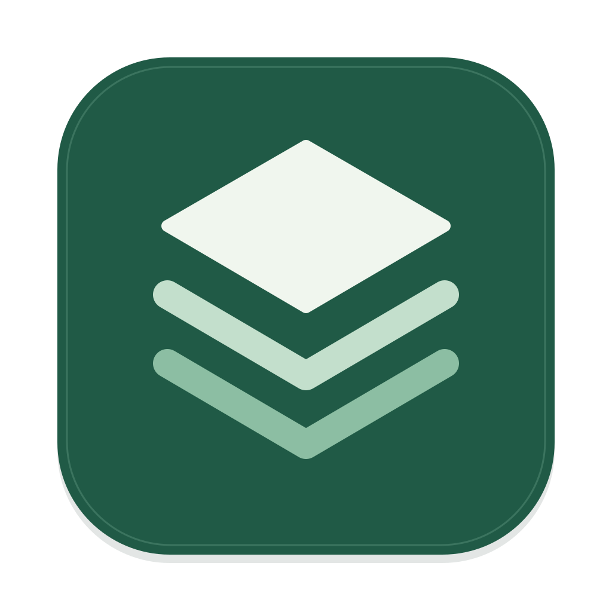
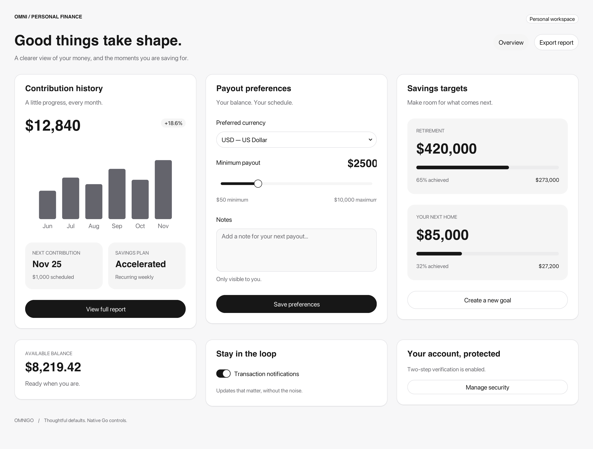

<div align="center">
  
  <h1>OmniGo</h1>
  <p><strong>Build desktop apps in Go. Bring your ideas to the screen.</strong></p>
  <p>Go controls · Web interfaces · Typed services · Optional plugins</p>
  <p><a href="README.md">简体中文</a> / <strong>English</strong></p>
  <p><a href="#quick-start">Quick start</a> · <a href="studio/README.md">Studio</a> · <a href="docs/architecture.md">Architecture</a> · <a href="examples">Examples</a></p>
</div>

---

OmniGo is a Go desktop application framework under active development. Compose windows, interfaces, and services with declarative configuration; let the framework manage execution, resource hosting, and shutdown.

> **Developer preview**: APIs may change. macOS Apple Silicon is the primary platform with native validation. See the support matrix below for platform-specific limits.

<picture>
  <source media="(prefers-color-scheme: dark)" srcset="docs/images/controls-dark.png">
  
</picture>

<p align="center"><sub>Actual Go-rendered example · Light and dark artwork follows your document theme · Illustrative data</sub></p>

## Why OmniGo

| Capability | What it enables |
| --- | --- |
| **Interfaces written in Go** | Compose controls, layouts, themes, and events with `baseui`; keep interface state in Go. |
| **A small application entry point** | Declare an app with `omnigo.Run`; register typed calls with `Query` and `Method`. |
| **Native and Web interfaces** | Use Go content windows or connect a Web frontend to Go services through OmniWeb. |
| **Managed lifetimes** | Register background services for cooperative cancellation and cleanup; dispatch results back to the UI. |
| **Optional extensions** | Select Markdown, terminal, database, browser, and other plugins according to their documented implementation status. |
| **Inspectable performance** | CPU-rendered Go controls, direct RGBA presentation on macOS, benchmarks, and native validation commands. |

<a id="quick-start"></a>

## Quick start

Requires **Go 1.26+**. Clone the repository and run a native counter. This native application entry point currently supports macOS.

```sh
git clone https://github.com/herlanai/omnigo.git
cd omnigo
CGO_ENABLED=0 go run ./examples/desktop-counter
```

A complete Go window application:

```go
package main

import (
    "fmt"
    "log"

    "github.com/herlanai/omnigo"
    ui "github.com/herlanai/omnigo/omniui/baseui"
)

func main() {
    err := omnigo.Run(omnigo.Options{
        GoWindow: func(omnigo.WindowEnvironment) (omnigo.ContentWindowOptions, error) {
            count := 0
            return omnigo.ContentWindowOptions{
                Title: "Hello, OmniGo", Width: 480, Height: 300,
                View: func() *ui.Element {
                    return ui.Column("root",
                        ui.Heading("title", "Hello, OmniGo", 1),
                        ui.Text("count", fmt.Sprintf("Count: %d", count)),
                        ui.Button("add", "Add one", func() { count++ }),
                    ).Padding(24).Gap(16)
                },
            }, nil
        },
    })
    if err != nil {
        log.Fatal(err)
    }
}
```

Ordinary Go control applications do not need Node.js. Keep UI state on its UI goroutine; use dispatch facilities such as the window's `RunTask` to apply background results.

## Explore Omni Studio

Studio brings together controls, icons, WebView, an optional browser, and process metrics. Its main window hosts a Web interface; Go control demos run in native windows.

Requires **Node.js 24+ and pnpm 10.33**. Run from the repository root:

```sh
pnpm install --frozen-lockfile
pnpm dev       # Build and launch Studio
pnpm build     # Produce build/studio/Omni Studio.app
pnpm start     # Launch the existing build
pnpm package   # Create a distribution archive
```

The **optional Chromium demo** requires a separately built CEF host, followed by a Studio rebuild:

```sh
pnpm setup:chromium
pnpm build
```

Building the CEF host requires CMake and a native C++ toolchain. Ordinary Go targets support `CGO_ENABLED=0`; this separate host has additional build dependencies. See the [Studio guide](studio/README.md) and [Chromium plugin](omniui/plugins/chromium/README.md).

## Choose your interface

| Approach | Entry point | Use case |
| --- | --- | --- |
| **Native Go content** | `Options.GoWindow` + `baseui` | Write controls, layout, and interactions in Go. |
| **Web main window** | `Options.Assets` + `Options.Window` | Host frontend assets and call Go through OmniWeb. |
| **Embedded WebView** | `apps/host.WebViewOptions` | Place a real WKWebView inside a Go layout. |
| **Standalone Web app** | OmniWeb project template | Combine TanStack Start, React, and TypeScript with Go services. |

The Web template currently generates a browser application. Native window support and the Web protocol evolve independently. See the [OmniWeb guide](docs/omniweb.md).

## Platform support

| Platform | Go target builds | Native runtime status |
| --- | --- | --- |
| macOS arm64 | `CGO_ENABLED=0` | AppKit, WKWebView, and Studio have native validation; developer preview. |
| macOS amd64 | `CGO_ENABLED=0` | Cocoa host implemented; Intel hardware validation pending. |
| Windows amd64 / arm64 | `CGO_ENABLED=0` | Optional experimental Win32 software windows; Studio host unavailable. |
| Linux amd64 / arm64 | `CGO_ENABLED=0` | Optional experimental X11 software windows; Studio host unavailable. |

Cross-compilation does not establish native compatibility. Full IME support, system accessibility, complex text shaping, and a unified multi-window API remain in progress. Go controls primarily use CPU rendering; GPU support is partial and experimental.

## Project layout

```text
omnigo/                 Application entry points, windows, services, registrations
├── apps/               Platform hosts, windows, clipboard, and metrics
├── omniui/baseui/      Go controls, layout, themes, input, and rendering
├── omniui/plugins/     Optional feature plugins
├── omniweb/            Web protocol, asset hosting, and TypeScript client
├── runtime/            Lifecycle, dispatch, events, RPC, and downloads
├── text/rope/          Immutable text storage
├── i18n/               Language catalogs and message formatting
├── studio/             Developer showcase application
└── examples/           Runnable examples
```

## Documentation and development

- [Architecture and naming](docs/architecture.md) · Responsibilities, dependency boundaries, and API migration.
- [Go controls](omniui/baseui/README.md) · Usage and current limitations.
- [Plugin directory](omniui/plugins/README.md) · Optional plugins and implementation status.
- [Performance](docs/performance.md) · Measurement methodology and benchmark evidence.
- [Studio](studio/README.md) · Running, packaging, and exploring demos.

The linked detailed guides are primarily in Chinese.

```sh
sh scripts/check.sh
```

The checks cover Go tests, vet, race detection, TypeScript SDK tests, and CGO-disabled builds for six desktop targets. Follow the [repository rules](AGENTS.md), validate interactions with deterministic events and explicit clocks, and support performance claims with equivalent workloads.

The light and dark illustrations are actual Go-rendered output from [`examples/control-showcase`](examples/control-showcase). Third-party component, font, and asset licenses and attribution remain in their respective directories. See the [distribution notices](studio/THIRD_PARTY_NOTICES.md).
