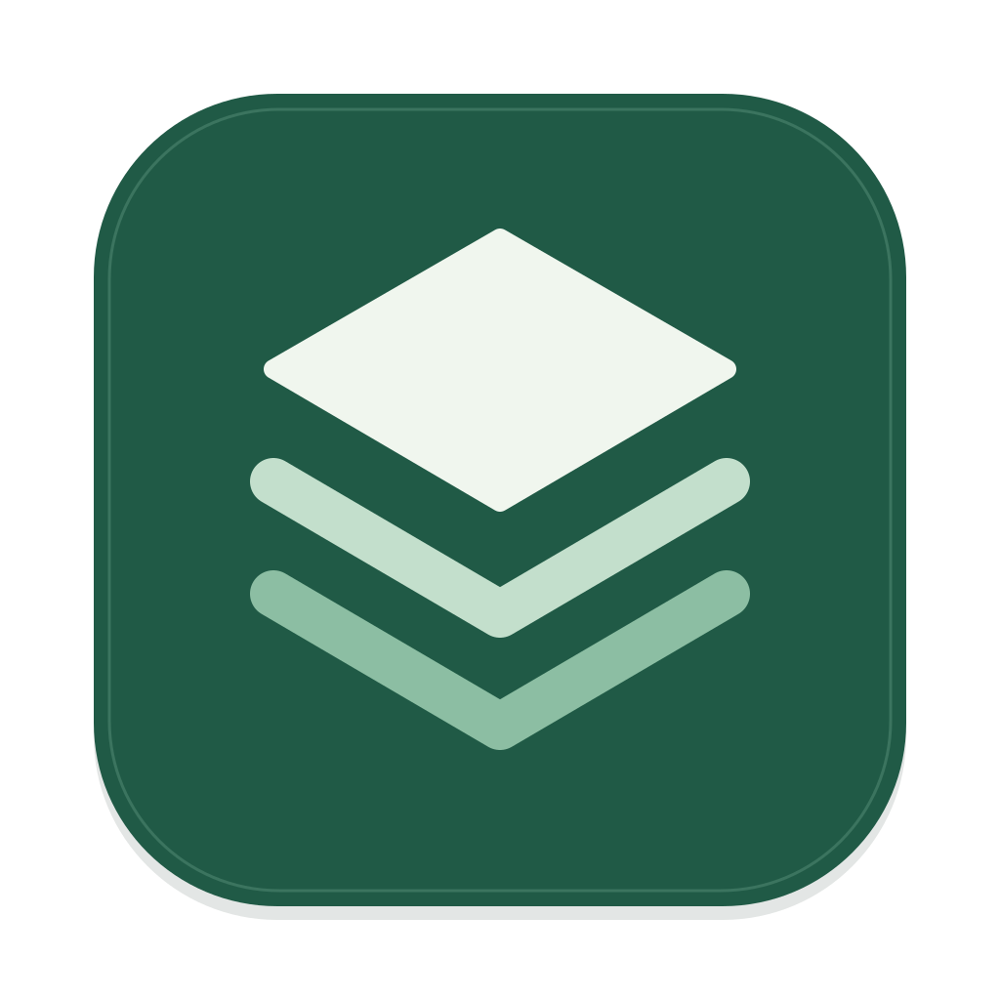
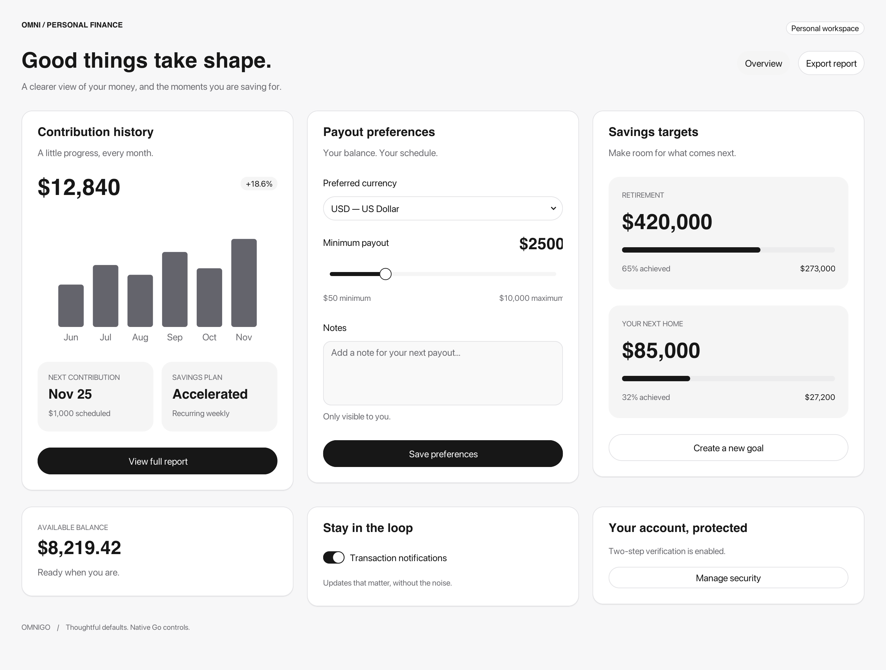

<div align="center">
  
  <h1>OmniGo</h1>
  <p><strong>用 Go 构建桌面应用，让想法成为界面。</strong></p>
  <p>Go 控件 · Web 界面 · 类型化服务 · 可选插件</p>
  <p><strong>简体中文</strong> / <a href="README.md">English</a></p>
  <p><a href="#quick-start">快速开始</a> · <a href="examples/studio/README.md">Studio</a> · <a href="docs/architecture.md">架构</a> · <a href="examples">示例</a></p>
</div>

---

OmniGo 是一个正在积极开发的 Go 桌面应用框架。通过声明式配置组合窗口、界面与服务，由框架管理应用运行、资源托管及退出清理。

> **开发预览**：API 仍可能调整。当前主要原生验证平台为 macOS Apple Silicon；各平台的实际支持范围见下表。

<picture>
  <source media="(prefers-color-scheme: dark)" srcset="docs/images/controls-dark.png">
  
</picture>

<p align="center"><sub>由 Go 控件绘制的示例界面 · 随文档主题切换明暗配图 · 示例数据仅用于展示</sub></p>

## 为什么选择 OmniGo

| 能力 | 你可以做什么 |
| --- | --- |
| **Go 编写界面** | 使用 `baseui` 组合控件、布局、主题和事件，在 Go 中管理界面状态。 |
| **简洁的应用入口** | 使用 `omnigo.Run` 声明应用，使用 `Query`、`Method` 注册类型化调用。 |
| **原生与 Web 两条路径** | 选择 Go 内容窗口，或通过 OmniWeb 将 Web 前端连接到 Go 服务。 |
| **生命周期托管** | 注册后台服务，统一取消、等待和清理；后台结果经调度回到 UI。 |
| **按需扩展** | 选择 Markdown、终端、数据库、浏览器等可选插件，按各插件的实现范围使用。 |
| **可检查的性能** | Go 控件使用 CPU 绘制，macOS 直接提交 RGBA；提供基准与原生验证入口。 |

<a id="quick-start"></a>

## 快速开始

**Go 1.26+**。先克隆仓库，再运行一个原生计数器。以下原生应用入口当前支持 macOS。

```sh
git clone https://github.com/herlanai/omnigo.git
cd omnigo
CGO_ENABLED=0 go run ./examples/desktop-counter
```

一个完整的 Go 窗口应用：

```go
package main

import (
    "fmt"
    "log"

    "github.com/herlanai/omnigo"
    ui "github.com/herlanai/omnigo/omniui/baseui"
)

func main() {
    err := omnigo.Run(omnigo.Options{
        GoWindow: func(omnigo.WindowEnvironment) (omnigo.ContentWindowOptions, error) {
            count := 0
            return omnigo.ContentWindowOptions{
                Title: "Hello, OmniGo", Width: 480, Height: 300,
                View: func() *ui.Element {
                    return ui.Column("root",
                        ui.Heading("title", "Hello, OmniGo", 1),
                        ui.Text("count", fmt.Sprintf("Count: %d", count)),
                        ui.Button("add", "Add one", func() { count++ }),
                    ).Padding(24).Gap(16)
                },
            }, nil
        },
    })
    if err != nil {
        log.Fatal(err)
    }
}
```

普通 Go 控件应用无需 Node.js。界面状态应由 UI goroutine 使用；后台工作通过窗口的 `RunTask` 等调度入口返回 UI。

## 体验 Omni Studio

Studio 集中展示控件、图标、WebView、可选浏览器和进程指标。主窗口使用内嵌 Web 界面，Go 控件演示在原生窗口中运行。

需要 **Node.js 24+、pnpm 10.33**，在仓库根目录执行：

```sh
pnpm install --frozen-lockfile
pnpm dev       # 构建并启动 Studio
pnpm build     # 生成 build/studio/Omni Studio.app
pnpm start     # 启动已构建的应用
pnpm package   # 生成分发归档
```

**可选 Chromium 演示**需要单独构建 CEF 宿主，然后重新打包：

```sh
pnpm setup:chromium
pnpm build
```

CEF 宿主构建需要 CMake 和原生 C++ 工具链。普通 Go 目标支持 `CGO_ENABLED=0`；这个独立宿主有额外构建依赖。详见 [Studio 指南](examples/studio/README.md) 和 [Chromium 插件](omniui/plugins/chromium/README.md)。

## 选择界面方式

| 方式 | 入口 | 适用场景 |
| --- | --- | --- |
| **Go 原生内容** | `Options.GoWindow` + `baseui` | 在 Go 中编写控件、布局与交互。 |
| **Web 主窗口** | `Options.Assets` + `Options.Window` | 托管前端资源，通过 OmniWeb 调用 Go。 |
| **内嵌 WebView** | `omniwindow/host.WebViewOptions` | 在 Go 布局中展示真实 WKWebView。 |
| **独立 Web 应用** | OmniWeb 项目模板 | TanStack Start、React、TypeScript 与 Go 服务组合。 |

Web 模板当前生成浏览器应用。原生窗口能力与 Web 协议分别演进，详见 [OmniWeb 指南](docs/omniweb.md)。

## 平台支持

| 平台 | Go 目标构建 | 原生运行状态 |
| --- | --- | --- |
| macOS arm64 | `CGO_ENABLED=0` | AppKit、WKWebView 及 Studio 有原生验证，仍处于开发预览。 |
| macOS amd64 | `CGO_ENABLED=0` | 已接入 Cocoa 宿主；待 Intel 实机验收。 |
| Windows amd64 / arm64 | `CGO_ENABLED=0` | 可选实验性 Win32 软件窗口；Studio 宿主尚未接入。 |
| Linux amd64 / arm64 | `CGO_ENABLED=0` | 可选实验性 X11 软件窗口；Studio 宿主尚未接入。 |

跨平台编译不等于原生兼容性验收。完整 IME、系统无障碍、复杂文字整形及统一多窗口 API 仍在完善中。Go 控件当前以 CPU 渲染为主，GPU 支持处于局部实验阶段。

## 项目结构

```text
omnigo/                 应用入口、窗口配置、服务与注册
├── omniwindow/         平台能力：宿主、窗口、剪贴板、指标
├── omniui/baseui/      Go 控件、布局、主题、输入与绘制
├── omniui/plugins/     可选功能插件
├── omniweb/            Web 协议、资源托管与 TypeScript 客户端
├── internal/           框架内部实现
│   ├── apphost/        应用 HTTP 生命周期与单实例交接
│   ├── codegen/        类型契约文件生成与发布
│   ├── runtime/        生命周期、调度、事件、RPC 与下载
│   ├── text/rope/      不可变文本存储
│   └── scaffold/       项目模板
├── tests/architecture/ 仓库依赖边界检查
├── i18n/               语言目录与消息格式
└── examples/           可运行的使用示例
    └── studio/         开发演示应用
```

## 文档与开发

- [架构与命名](docs/architecture.md) · 模块职责、依赖边界与 API 迁移说明。
- [Go 控件](omniui/baseui/README.md) · 控件使用方式与当前限制。
- [插件目录](omniui/plugins/README.md) · 可选插件及实现状态。
- [性能说明](docs/performance.md) · 测量口径与基准证据。
- [Studio](examples/studio/README.md) · 运行、打包和演示操作。

```sh
sh scripts/check.sh
```

检查包括 Go 测试、vet、race、TypeScript SDK 测试与六个桌面目标的 CGO 禁用构建。贡献时请遵循 [仓库规则](AGENTS.md)，使用确定事件与显式时钟验证交互，并提供等价负载的性能证据。

配图来自 [`examples/control-showcase`](examples/control-showcase)，明暗图均为实际 Go 渲染输出。第三方组件、字体与资源的许可及署名随各自目录保留，分发说明见 [第三方声明](examples/studio/THIRD_PARTY_NOTICES.md)。
