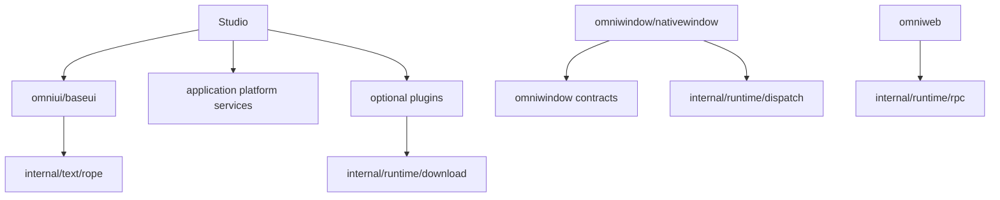

# OmniGo 架构与复用边界

框架按职责分层，依赖由宿主和组合层指向基础能力。共享实现放在实际拥有该职责的模块，不建立跨领域的 `utils` 集合，也不为了目录对称复制一套实现。

## 模块归属

| 模块 | 负责 | 不负责 |
| --- | --- | --- |
| 根包 `omnigo` | 公开应用入口、类型化服务绑定、窗口配置；组合现有生命周期与资源托管 | 演示数据、Studio 专属业务 |
| `internal/apphost` | 应用 HTTP 服务生命周期、单实例启动转发与 UI 就绪交接 | 公开入口类型、业务注册、平台驱动 |
| `internal/codegen` | 类型契约生成后的文件发布，保持旧文件及未变化内容 | RPC 协议或 CLI 参数解析 |
| `internal/runtime/lifecycle` | 服务生命周期及后台任务启动、取消和等待 | 应用窗口配置 |
| `tests/architecture` | 仓库源码依赖边界检查 | 应用运行时代码 |
| `omniwindow` | 窗口与平台契约 | 控件布局和绘制 |
| `omniwindow/host` | 可选 Cocoa/WebKit 宿主、Go 内容窗口、输入、绘制提交、标题栏、资源清理 | Studio 的演示 ID、图标和 HTML 示例 |
| `omniwindow/metrics` | Go runtime 与原生进程/系统指标采样 | 性能面板展示 |
| `omniwindow/nativewindow` | Win32/X11 窗口、事件路由、父子关系、帧提交 | WebView、控件树、业务状态 |
| `omniwindow/clipboard`、`omniwindow/system`、`omniwindow/accelerator` | 各自独立的系统数据/服务契约与适配 | Studio 的展示和业务逻辑 |
| `internal/runtime/dispatch`、`event`、`rpc` | UI 派发、事件和调用基础设施 | 具体控件或平台初始化 |
| `internal/runtime/download` | 下载元数据校验、重试、哈希、暂存、缓存锁与发布 | 更新签名、版本选择、安装和重启 |
| `internal/text/rope` | 不可变文本版本、坐标和编辑算法 | 选择区、IME、控件、排版 |
| `i18n` | 语言目录、匹配、消息格式 | 窗口和控件生命周期 |
| `omniui/baseui` | Go 控件、布局、主题、交互、编辑历史和 CPU 绘制 | 默认链接所有原生后端和可选插件 |
| `omniui/baseui/gpu` 与可选控件子包 | 应用显式选择的渲染/控件能力 | 通过副作用注册到基础控件 |
| `omniui/plugins` | 可选服务及其领域策略；updater 验证签名后复用下载层 | 重写通用下载、派发或文本存储 |
| `omniweb` | Web UI 协议与 HTTP 宿主，复用 RPC | 冒充 Go 原生控件实现 |
| `examples/studio` | 组合、演示、目录与应用打包 | 成为公共框架功能的唯一实现位置 |

Cocoa 宿主已迁入公开的 `omniwindow/host`，不再反向依赖 Studio。Studio 通过根包 `omnigo.New`、`omnigo.Bind`、`app.ConfigureMainWindow` 和 `app.Run` 启动；资源服务器复用 OmniWeb，扩展生命周期复用 `lifecycle.Manager`。窗口工厂只提供 Go 控件内容与应用回调。Windows/Linux 的软件驱动仍在 `omniwindow/nativewindow`，`host` 已有可选 WebView2 和 GTK4/WebKitGTK6 Web 主窗口后端，Go 内容窗口与平台服务仍有缺口。具体支持和证据统一见 [当前状态](status.md)；跨编译不代表实机验收。

## 已合并的实现

### 原生窗口

父窗和子窗共享 `frameState` 以及 `drainFrame`、`handleEvent`、`renderFrame`、`frameTimeout`。输入/尺寸事件、关闭拦截、绘制结果校验和动画截止时间只维护一份。每个窗口仍拥有自己的状态和截止时间，根循环提供同一显式时钟。

`window.go` 负责根循环与驱动生命周期；`children.go` 负责窗口树和叶子优先销毁；`frame.go` 负责单窗口的帧行为。Win32/X11 文件只处理原生操作和事件转换。根窗口退出与子树关闭的责任不同，保留在各自所有者中，不强行合并成布尔参数众多的通用循环。

### 下载和更新

`File.Validate` 是元数据校验入口；`Get` 发布到指定路径；`Stage` 返回调用方拥有的私有已校验文件；`Cached` 加入跨进程锁。三个执行入口共用规范化后的下载循环，不重复克隆请求配置、实现网络重试或管理验证算法。

updater 只维护签名、版本、发布文件必须有确定大小等领域约束，并将签名清单的总大小映射给进度回调。其原有 HTTP 主机白名单比通用下载层更严格，继续保留这一差异，避免“去重”意外扩大允许范围。临时文件预留、失败清理和下载归下载层所有。

### 文本状态

`TextBuffer` 的持久化文档和历史版本复用 `internal/text/rope`。控件仍负责选择区、IME 组合和撤销/重做；当前字符串是绘制兼容缓存，不作为第二套编辑算法。全文字符串物化和字素簇/复杂文字整形仍是后续工作，不能将文本树优化等同于整个编辑器已完成。

## 保持独立的相似代码

- `omniui` 的不可变节点和补丁是协议数据模型；`baseui` 是真实控件、布局和交互。两者不因名称相似就合并。
- 文本 diff、界面树 diff、图像比较处理不同数据和语义，不合并为含大量模式开关的算法。
- 平台句柄、IME、窗口所有权和销毁顺序存在 ABI/系统差异；共享行为与原生适配分开，不能抽成空操作统一接口来宣称支持。
- 测试夹具服务于不同故障场景，少量重复优先于跨包共享可变测试状态。

## 生命周期与并发约束

Surface、控件状态、原生窗口与 GPU 设备由所属 UI goroutine 使用；后台结果经 `internal/runtime/dispatch` 派发。不可变文本版本可并发读取，不代表可从后台修改 TextBuffer。不得跨帧保留 Painter。

应用按依赖顺序启动，失败逆序回滚；停止使用独立清理上下文。派发队列有容量和单轮上限，UI 回调不能等待自己的派发结果。下载进度在下载调用 goroutine 同步执行，展示进度必须由宿主派发到 UI。

## 验证

核心修改运行 `sh scripts/check.sh`：测试、vet、race、SDK 测试、六个 `CGO_ENABLED=0` 桌面目标构建。窗口共享行为用显式时钟验证独立截止时间、关闭/失败清理及错误帧拒绝；下载验证取消、校验失败、旧文件保留、分块进度、URL 策略和真实跨进程缓存串行化。

检查依赖时使用 `go list`，确认基础控件没有引入原生窗口、GPU 或服务插件。性能提升须有等价负载 benchmark；重构减少重复不能直接换算为性能倍数。

## 应用命名与包迁移（2026-11-12）

公共应用入口仍是根包 `omnigo`。平台能力统一位于 `omniwindow`；原 `desktop/uiapp`
迁为 `omniwindow/host`，控制对象为 `host.Controller`。扩展生命周期独立为
`internal/runtime/lifecycle.Manager`，不承担窗口配置和原生事件处理。

根包按职责拆分：application.go（构造）、run.go（运行）、window.go（窗口）、
binding.go（RPC）、registration.go（注册组合）、service.go（后台服务）、
http.go（资源与路由）。平台实现使用 `_darwin.go` 等系统后缀。

此次是源码级破坏性迁移，仓库内所有调用已更新；没有保留旧导入路径的转发包。

| 旧 API | 新 API |
| --- | --- |
| desktop / apps | omniwindow |
| desktop/uiapp / apps/host | omniwindow/host |
| desktop.Application、desktop.Options、desktop.New | lifecycle.Manager、lifecycle.Options、lifecycle.New |
| uiapp.Host、uiapp.Services | host.Controller、host.WindowServices |
| Module、Modules、Compose | Registration、Registrations、Group |
| Content、WindowContext | ContentWindowOptions、WindowEnvironment |
| NewWindow（主窗口配置） | ConfigureMainWindow |
| OpenWindow（注册内容窗口） | OpenContentWindow |
| SetTitlebar（含查询） | TitleBarState / SetTitleBar |
| Content.HTML、WebViewReady、WebPageReady | ContentWindowOptions.WebView 下的 HTML、OnStateReady、OnReady |

默认应用仍使用 `omnigo.Run` 和 `Options.Window` / `GoWindow`。多内容窗口保留
工厂入口；完整的统一窗口对象属于后续行为改造，不由这次改名提供。
Studio 保持现有 RPC 路径兼容，在服务适配层将空标题栏请求转换为显式查询。
通知回调逐步使用 On 前缀，能力布尔值使用 Supports 前缀。

## 内部实现边界

`runtime` 和 `text` 已迁到 `internal/runtime`、`internal/text`。外部模块不得
直接导入这些路径；仓库内示例和测试仍可用于验证内部算法。

公开入口保持可用：应用生命周期配置使用 `omnigo.LifecycleOptions`；独立 Web
宿主使用 `omniweb.NewRouter` / `omniweb.Bind`；文本快照使用
`baseui.TextSnapshot` / `TextSummary`；自动化自建队列使用
`automation.NewDispatchQueue`。这些入口复用内部实现。生成的项目只导入公开包，
并通过独立 module 的编译与调用测试验证 Go 的 internal 边界。

## 根目录 Go 文件的保留原则

根目录是 `github.com/herlanai/omnigo` 包。`Application`、`Options`、`Run`、
泛型 `Bind`/`Method`/`Query` 和应用方法继续放在这里，保持现有导入路径、
类型身份和方法集合。Go 不允许在另一个包中为这些类型定义方法，因此
`dialog.go`、`tray.go`、`window.go` 等公开入口文件应保留为薄封装。

实现按所有权下沉：HTTP 监听与退出、单实例交接在 `internal/apphost`；
后台任务在已有 `internal/runtime/lifecycle`；生成文件写入在
`internal/codegen`。单实例底层锁和平台服务仍留在原有 `omniwindow` 子包。
这些内部包不反向导入根包，也不承担 Studio 业务。

实现级测试随实现放置；需要访问 `Application` 私有状态和替换原生驱动的
根包集成测试保留。源码依赖检查移至 `tests/architecture`。新文件归属以职责
为依据，不再向根包添加独立的内部实现，也不建立通用 `utils` 包。

## 移动宿主边界

根包 MobileOptions/RunMobile 是公开移动入口。omniwindow/mobile 负责移动生命周期、
触摸、坐标和原生帧提交，复用 baseui；internal/mobilebuild 负责 iOS/Android
打包，CLI 只解析配置与命令。桌面根包组合文件通过 !ios && !android 隔离。
移动宿主用 x/mobile 的 cgo 原生桥接，桌面依赖图不链接该宿主。
当前不是 nsgo 原生控件树移植，也不表示手机 IME/无障碍已经继承桌面实现。
详见 [移动端构建与限制](mobile.md)。
